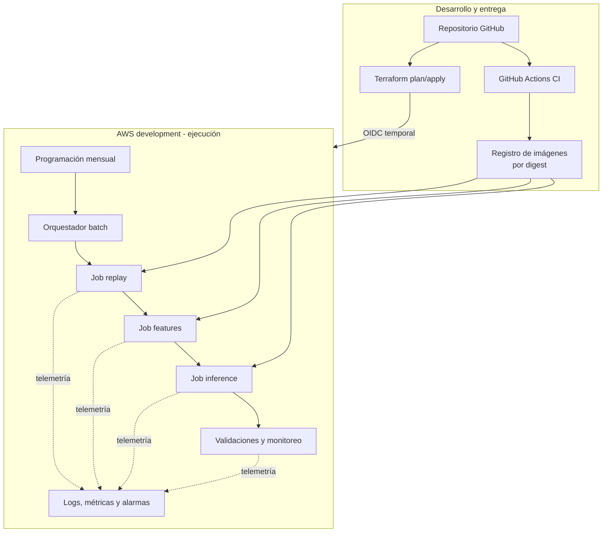
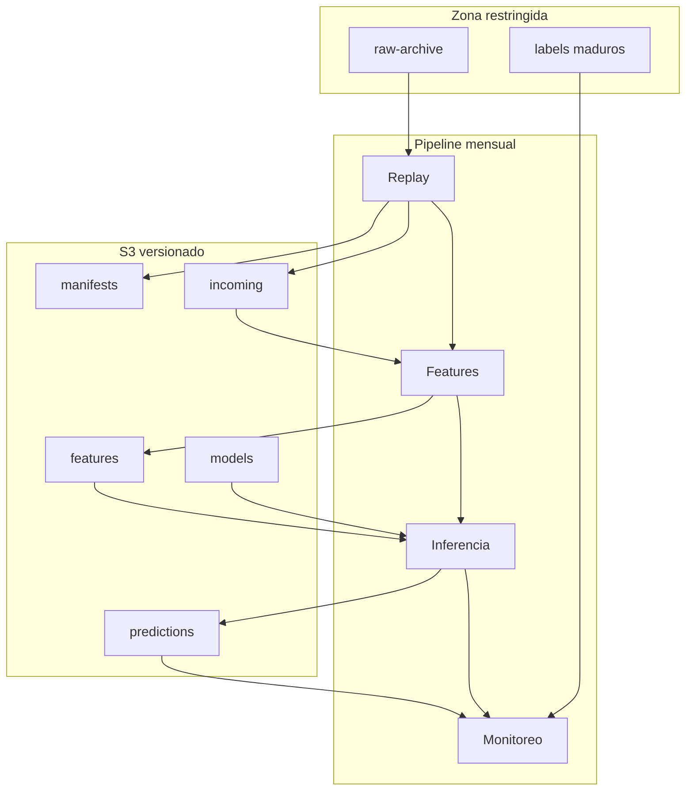
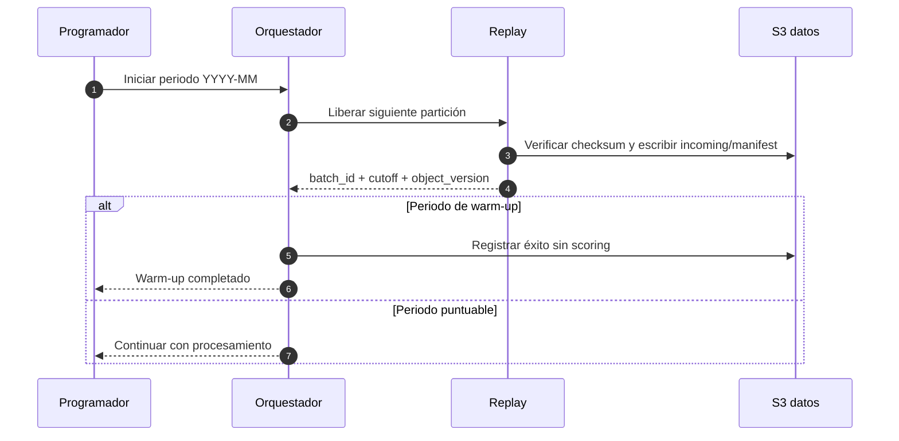
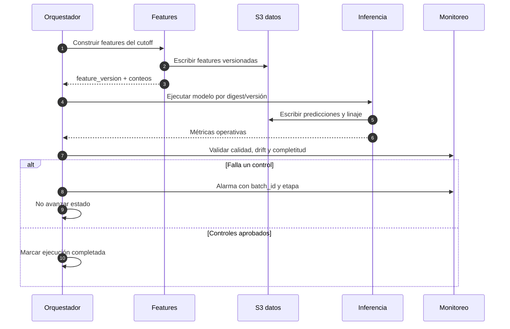
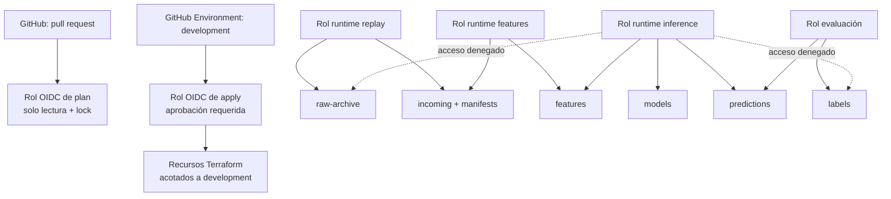
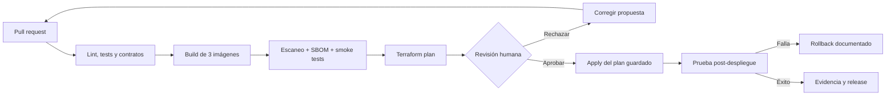
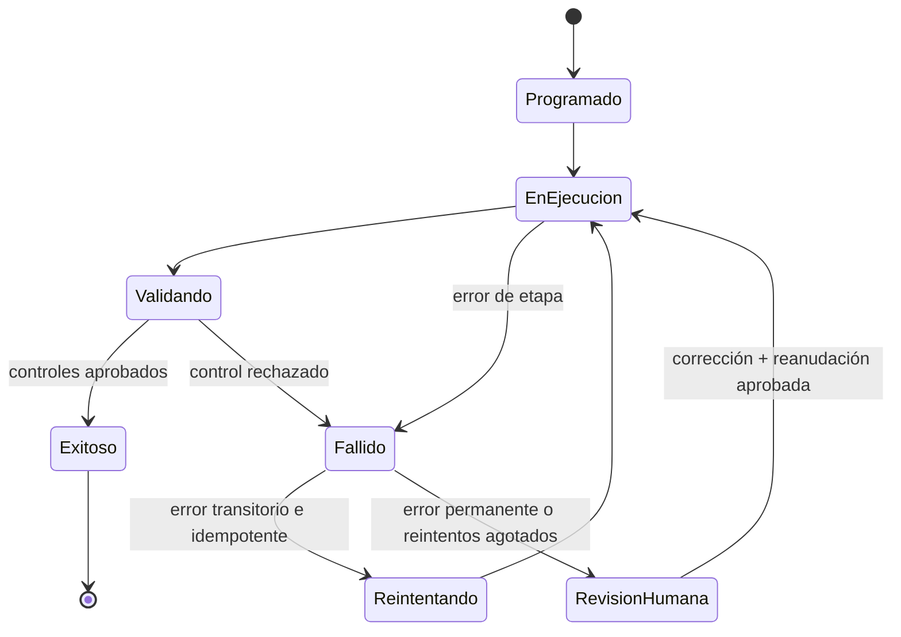

# Desarrollo técnico de la plataforma MLOps

> Estado: propuesta de arquitectura para revisión
>
> Última actualización: 2026-09-18
>
> Alcance: infraestructura y operación MLOps; no modifica el desarrollo científico

## 1. Propósito

Este documento describe cómo evolucionar el pipeline local de riesgo crediticio
hacia una plataforma batch en AWS que sea reproducible, auditable y de bajo
costo. Sirve como contrato entre el propietario del proyecto y el agente que
implementará el código.

Las decisiones todavía abiertas se registran en [`docs/adr/`](adr/README.md).
Una opción descrita aquí no se considera autorizada hasta que su ADR figure como
`Aceptado`.

### Cómo ampliar los diagramas

Los diagramas se mantienen en orientación vertical y se dividen cuando contienen
demasiados componentes, porque los visores Markdown reducen automáticamente los
gráficos muy anchos. Para examinarlos con más detalle se puede:

- usar el zoom del navegador (`Ctrl` + `+` o `Cmd` + `+`);
- copiar únicamente el bloque `mermaid` en
  [Mermaid Live Editor](https://mermaid.live/) y usar sus controles de zoom;
- exportarlo desde ese editor como SVG, que conserva calidad al ampliarse.

No se recomienda aumentar el tamaño mediante HTML o CSS dentro del Markdown:
GitHub puede filtrarlo y otros visores lo interpretan de manera diferente.

## 2. Principios y restricciones

- El caso de uso es educativo y no debe utilizarse para decisiones crediticias.
- El scoring es mensual y batch; no existe una necesidad actual de API en línea.
- La arquitectura debe privilegiar costo bajo y recursos que puedan permanecer
  apagados fuera de una ejecución.
- Los datos futuros, las etiquetas inmaduras y los prefijos restringidos no
  deben ser accesibles desde inferencia.
- Cada predicción debe ser trazable hasta datos, código, imagen y modelo.
- Terraform administra la infraestructura; no se aceptan cambios manuales no
  reconciliados.
- GitHub Actions accede a AWS mediante OIDC y credenciales temporales, nunca
  mediante access keys permanentes.
- Todo `apply`, promoción de modelo y cambio destructivo requiere aprobación
  humana.
- No se despliegan NAT Gateway, EKS, RDS, balanceadores ni EC2 permanente en la
  primera versión.

## 3. Estado de partida

### Implementado y comprobable en el repositorio

- Pipeline local mensual de tres contenedores: replay, features e inferencia.
- Archivo histórico inmutable y liberación cronológica con checksum y manifiesto.
- Modelo campeón `0.1.0`, contrato de inferencia, diccionario y política de
  monitoreo.
- Pruebas unitarias, científicas y de integración de contenedores en CI.
- Stacks Terraform separados para laboratorio local, bootstrap y development.
- Configuración Terraform para state remoto S3, OIDC de GitHub y bucket de datos
  de development.

### Pendiente de verificación o implementación

- El estado real desplegado en AWS no se infiere desde los archivos Terraform.
- Ejecución administrada del pipeline en AWS.
- Registro y publicación inmutable de imágenes.
- Orquestación, alarmas, paneles y notificaciones operativas.
- Flujo completo de labels maduros, evaluación, reentrenamiento y promoción.
- Entornos staging/production y recuperación probada.

## 4. Arquitectura objetivo

Los siguientes diagramas muestran la dirección propuesta. Se separan la entrega,
la ejecución y los datos para conservar una escala legible. Los componentes con
una decisión pendiente deben ajustarse al ADR correspondiente antes de
implementarse.





El runtime ECS sobre Fargate fue aceptado en ADR-0001, la orquestación mediante
EventBridge Scheduler y Step Functions Standard en ADR-0002, y el estado de
replay mediante manifiestos y cursor en S3 versionado en ADR-0003.

## 5. Flujo mensual de datos

### 5.1 Liberación del periodo



### 5.2 Procesamiento y scoring



### Contrato mínimo de cada batch

Cada manifiesto y salida de predicción debe incluir:

| Campo | Finalidad |
|---|---|
| `batch_id` y periodo | Identidad idempotente de la ejecución |
| `dataset_id` y versiones S3 | Reproducir los datos exactos |
| `observation_cutoff` | Demostrar aislamiento temporal |
| `feature_pipeline_version` | Reproducir transformaciones |
| `model_version` y checksum | Identificar el bundle aprobado |
| `git_sha` | Identificar el código fuente |
| `image_digest` | Identificar el runtime inmutable |
| `orchestration_run_id` | Correlacionar logs, métricas y reintentos |
| conteos de entrada/salida | Detectar pérdida o duplicación de filas |

Una etapa se reintenta únicamente si es idempotente. El estado de replay no se
avanza hasta que la escritura, el checksum y el manifiesto se hayan confirmado.

## 6. Organización del almacenamiento

Se propone un bucket de datos versionado por entorno con prefijos y permisos
independientes:

```text
s3://<bucket-development>/
├── raw-archive/       # fuente histórica; solo replay puede leer
├── incoming/          # particiones liberadas cronológicamente
├── features/          # datasets listos para inferencia
├── predictions/       # scores, decisiones y linaje
├── labels/            # outcomes maduros; inferencia no puede leer
├── models/            # bundles, firmas, métricas y model cards
└── manifests/         # auditoría de batches y controles
```

Los objetos se particionan al menos por `environment` y `period`. No se usan
nombres mutables como `latest` para ejecutar producción: la invocación recibe
una versión o checksum explícito. La retención definitiva, cifrado y separación
de buckets se resuelven en ADR-0004.

## 7. Seguridad e IAM



Controles obligatorios:

- `allowed_account_ids` en cada provider de Terraform.
- Protección de acceso público, TLS obligatorio, versionado y cifrado en S3.
- Roles distintos para plan, apply y cada responsabilidad de runtime.
- Condiciones OIDC ligadas al repositorio inmutable, rama o GitHub Environment.
- Secretos fuera del repositorio, logs y outputs Terraform.
- CloudTrail y logs sin datos sensibles; identificadores técnicos sí pueden
  registrarse.
- Revisión explícita del plan guardado antes del apply; el apply consume
  exactamente ese artefacto, no genera un plan nuevo.

## 8. CI/CD de aplicación e infraestructura



Separación de responsabilidades:

- **CI de código:** dependencias, compilación, tests, contratos, build,
  escaneo y digest.
- **Plan de infraestructura:** formato, validación, análisis de seguridad,
  costo estimado y plan guardado con caducidad corta.
- **Apply:** solo desde GitHub Environment protegido y tras aprobación.
- **Promoción de modelo:** conserva juntos bundle, threshold, contrato de
  features e imagen; no está implícita en un despliegue de infraestructura.

## 9. Observabilidad y respuesta a fallos

### Señales operativas

- Estado, duración, reintentos y memoria de cada job.
- Edad del último batch exitoso y periodo esperado.
- Conteos de entrada/salida, duplicados y fallos de schema/checksum.
- Error al cargar modelo, incompatibilidad de features y scores no finitos.
- Costos reales y previstos frente a los presupuestos configurados.

### Señales de datos y modelo

Se aplican los umbrales de
[`MONITORING_AND_RETRAINING.md`](MONITORING_AND_RETRAINING.md): distribución de
scores, tasa de decisión, nulos, rangos y PSI por batch; ROC-AUC, PR-AUC, KS,
Brier, calibración y recall cuando maduren las etiquetas.

Las alarmas operativas no promueven ni reentrenan automáticamente. Una alerta
abre una investigación; la promoción champion/challenger siempre es humana.

### Estados de ejecución



## 10. Fases de implementación

### Fase 0 — Aprobar decisiones

- Revisar los ADR y cambiar a `Aceptado` o `Rechazado` con una justificación.
- No implementar componentes afectados por un ADR pendiente.

**Salida:** arquitectura autorizada y decisiones trazables.

### Fase 1 — Fundación segura

- Confirmar state remoto S3, locking, versionado y recuperación.
- Terminar roles OIDC separados para plan y apply de development.
- Proteger el GitHub Environment y validar el plan guardado/aprobado.
- Desplegar el bucket de datos con guardrails de costo y destrucción.

**Aceptación:** no hay credenciales permanentes; un plan de PR no puede hacer
apply; restaurar una versión previa del state está documentado y probado.

### Fase 2 — Supply chain de contenedores

- Crear repositorios de imágenes y políticas de retención.
- Construir replay, features e inference una sola vez por commit.
- Escanear, generar evidencia y desplegar exclusivamente por digest.

**Aceptación:** el digest ejecutado coincide con el registrado en el manifiesto
del batch y las imágenes corren sin usuario root.

### Fase 3 — Pipeline batch administrado

- Implementar runtime y orquestación según los ADR aprobados.
- Crear roles de mínimo privilegio por job y prefijo.
- Migrar el contrato local sin cambiar sus reglas temporales.
- Incorporar idempotencia, reintentos controlados y alarmas.

**Aceptación:** warm-up 1997-10 a 1997-12 y scoring desde 1998-01 producen el
mismo resultado funcional que el golden batch local.

### Fase 4 — Monitoreo y labels maduros

- Publicar métricas operativas, calidad, drift y performance diferida.
- Aislar labels de inferencia y unirlos solo en evaluación.
- Crear dashboard, alarmas y runbook de incidentes.

**Aceptación:** una anomalía sintética genera alarma; un batch inválido no
avanza el estado; toda métrica se enlaza con un `batch_id`.

### Fase 5 — Reentrenamiento y promoción controlada

- Automatizar preparación y evaluación de challengers, no su aprobación.
- Comparar sobre cohortes idénticas y segmentos definidos.
- Implementar promoción y rollback atómicos del paquete completo.

**Aceptación:** una promoción requiere aprobación humana y el rollback recupera
modelo, threshold, features e imagen compatibles.

## 11. Matriz de responsabilidades

| Actividad | Propietario del proyecto | Agente de implementación | Automatización |
|---|---|---|---|
| Aprobar/rechazar ADR | Responsable | Consulta | No aplica |
| Proponer cambio técnico | Consulta | Responsable | No aplica |
| Implementar Terraform/código | Revisa | Responsable | Verifica |
| Revisar plan y costo | Aprueba | Explica | Genera evidencia |
| Aplicar en AWS | Aprueba | Supervisa | Ejecuta con OIDC |
| Promover modelo | Aprueba | Prepara evidencia | Evalúa candidato |
| Responder a incidentes | Decide impacto | Diagnostica/corrige | Alerta y registra |

## 12. Definición de terminado de la plataforma inicial

- Infraestructura reproducible desde Terraform y sin drift conocido.
- Pipeline mensual administrado, idempotente y trazable de extremo a extremo.
- Separación efectiva entre raw, labels, features, inferencia y administración.
- Imágenes y modelos inmutables identificados por digest/checksum.
- CI/CD sin secretos permanentes y con aprobación para cambios mutables.
- Alarmas, dashboard, runbooks, restauración y rollback probados.
- Costos dentro del límite aprobado y sin componentes siempre encendidos.
- ADR relevantes aceptados y documentación sincronizada con la implementación.

## 13. Documentos relacionados

- [`DATA_SCIENCE_HANDOFF.md`](../DATA_SCIENCE_HANDOFF.md)
- [`MLOPS_PROGRESS.md`](MLOPS_PROGRESS.md)
- [`MONITORING_AND_RETRAINING.md`](MONITORING_AND_RETRAINING.md)
- [`MODEL_CARD.md`](MODEL_CARD.md)
- [`DATA_DICTIONARY.md`](DATA_DICTIONARY.md)
- [`docs/adr/README.md`](adr/README.md)
