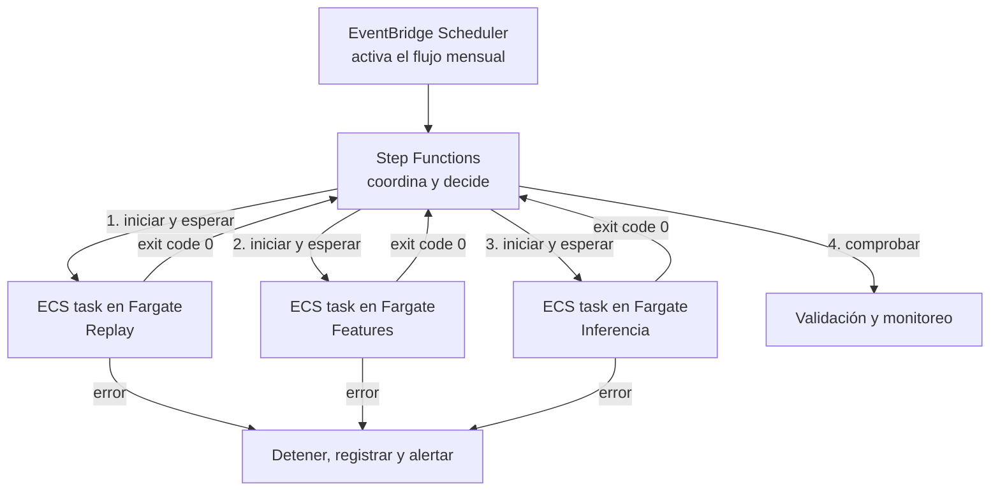

# ADR-0001: Runtime batch administrado

- Estado: Aceptado
- Fecha: 2026-09-19
- Propietario: Gonzalo
- Decisores: Gonzalo
- Reemplaza a: No aplica
- Reemplazado por: No aplica

## Contexto

El pipeline mensual ya se distribuye en tres imágenes Docker independientes:
replay, features e inferencia. Se necesita ejecutarlas en AWS sin servidores
permanentes, manteniendo aislamiento IAM, logs, reintentos y bajo costo.

## Drivers de decisión

- Cero capacidad encendida fuera de las ejecuciones mensuales.
- Compatibilidad directa con imágenes existentes.
- Aislamiento por rol y límites de CPU/memoria.
- Baja carga operativa y camino simple para un proyecto de portafolio.

## Opciones consideradas

### Opción A — ECS Fargate tasks

Ejecuta cada contenedor como tarea efímera. Ofrece roles por tarea, CloudWatch
Logs y control explícito de CPU/memoria. Requiere definir red, task definitions
y mecanismo de orquestación.

Esta es la opción aceptada.

### Opción B — AWS Batch sobre Fargate

Añade colas, job definitions, dependencias y políticas de reintento. Es útil si
crecen la concurrencia y el número de trabajos, pero introduce más componentes
que los necesarios para tres jobs mensuales.

### Opción C — Lambda con imágenes

Reduce administración, pero sus límites de duración, almacenamiento y modelo de
ejecución pueden forzar cambios al contrato actual y dificultar cargas futuras.

## Recomendación técnica

Elegir **ECS Fargate tasks** para la primera versión. Conserva los contenedores,
no mantiene servidores y evita la complejidad de una cola Batch antes de tener
volumen que la justifique.

## Resolución del propietario

- Decisión: [x] Aceptar recomendación / [ ] Elegir otra opción / [ ] Rechazar
- Opción elegida: Opción A — ECS Fargate tasks.
- Justificación: ejecutar los tres contenedores existentes como procesos batch
  efímeros, sin administrar servidores ni mantener capacidad encendida.
- Condiciones o cambios solicitados: la programación y coordinación mensual se
  resolverán de forma separada en ADR-0002. No se desplegará un ECS Service
  siempre activo para este pipeline.
- Fecha de decisión: 2026-09-19

## Qué significa esta decisión

Esta decisión define **dónde y cómo se ejecuta cada contenedor**, pero no define
**cuándo se inicia ni en qué orden se ejecutan los contenedores**.

- **ECS** administra la definición y ejecución de contenedores en AWS.
- **Fargate** proporciona temporalmente la CPU y memoria necesarias, sin crear
  ni administrar servidores EC2.
- Una **task** es una ejecución concreta y efímera. Termina cuando el proceso
  del contenedor finaliza.
- El **orquestador mensual** solicita esas tasks, espera sus resultados y decide
  cuál debe comenzar después.

Una forma breve de distinguirlos es:

> Fargate es el lugar donde trabaja cada etapa; el orquestador es quien dirige
> el trabajo completo.

## Relación con la orquestación mensual

La integración propuesta —todavía pendiente de aprobación en ADR-0002— sería:

El flujo exacto sería:

1. **EventBridge Scheduler** llega a la fecha configurada y crea una ejecución
   de Step Functions con el periodo, por ejemplo `1998-01`.
2. **Step Functions** pide a ECS ejecutar la task de replay sobre Fargate.
3. Fargate obtiene la imagen correspondiente, crea capacidad temporal y ejecuta
   el contenedor.
4. Step Functions espera. Si replay termina correctamente, inicia features; si
   falla, detiene el flujo y genera la ruta de error.
5. Repite el mismo patrón para inferencia y validación.
6. Al terminar cada task, Fargate libera la capacidad. No queda un contenedor ni
   un servidor esperando hasta el siguiente mes.

Por tanto, Step Functions no procesa datos ni ejecuta Python. Su función es
coordinar. ECS/Fargate no decide la secuencia mensual. Su función es ejecutar
cada contenedor bajo demanda.

Aceptar ADR-0001 no aprueba automáticamente EventBridge ni Step Functions. Esa
decisión continúa abierta en ADR-0002; Fargate también podría ser invocado por
otro orquestador si se eligiera una alternativa diferente.

## Glosario de términos

### Imagen de contenedor

Paquete inmutable que contiene el programa y sus dependencias. El proyecto tiene
imágenes separadas para replay, features e inferencia. En AWS se almacenarán en
un registro de imágenes, normalmente Amazon ECR.

### Amazon ECR

Registro privado donde se almacenan las imágenes de contenedor. Una task debe
usar una versión inmutable identificada por digest, no una etiqueta cambiante
como `latest`.

### Amazon ECS

Servicio que recibe una definición de tarea y administra su ejecución. En esta
arquitectura no aporta servidores: delega la capacidad de cómputo a Fargate.

### Cluster ECS

Agrupación lógica donde se ejecutan las tasks. Con Fargate no significa que haya
un clúster de servidores permanentemente encendidos.

### Task definition

Plantilla versionada que especifica qué imagen ejecutar, comando, CPU, memoria,
variables de entorno, logs, roles IAM y configuración de red. Habrá una task
definition por responsabilidad o una familia versionada para cada job.

### ECS task

Instancia en ejecución de una task definition. Para este proyecto una task
representa una ejecución de replay, features o inferencia para un periodo.

### ECS Service

Mecanismo que intenta mantener una cantidad permanente de tasks activas, común
en APIs y aplicaciones web. **No se utilizará para el pipeline mensual**, porque
los jobs deben terminar y quedar apagados.

### AWS Fargate

Motor de cómputo serverless para contenedores. `Serverless` no significa que no
existan servidores; significa que AWS los administra y el proyecto solicita
solo CPU y memoria para cada ejecución.

### Rol de ejecución de la task

Rol IAM utilizado por ECS para preparar la ejecución, por ejemplo descargar la
imagen desde ECR o enviar logs. No debe confundirse con los permisos del programa.

### Rol de la task

Rol IAM que utiliza el código dentro del contenedor. Se separará por job: replay
podrá leer raw e incoming; inferencia no podrá leer raw ni labels.

### Exit code

Número que devuelve el proceso al terminar. `0` significa éxito; un valor
distinto de cero significa fallo. El orquestador usa este resultado para avanzar
o detener el flujo.

### CloudWatch Logs

Destino administrado para los logs de cada task. Los registros se correlacionan
mediante `batch_id`, periodo y ejecución del orquestador.

### EventBridge Scheduler

Reloj administrado que inicia el proceso en una fecha o frecuencia establecida.
No ejecuta las transformaciones ni mantiene el estado completo del pipeline.

### Step Functions

Servicio de orquestación que representa el flujo como una máquina de estados:
orden, condiciones, timeouts, reintentos y rutas de error. Es una propuesta de
ADR-0002, no parte aprobada de este ADR.

### Orquestador

Componente que coordina varias etapas. Recibe el periodo, inicia cada task,
espera su resultado, aplica reglas de reintento y registra el estado global.

### Runtime

Entorno donde realmente se ejecuta el código. En esta decisión, el runtime es
ECS con capacidad Fargate.

## Consecuencias de la decisión

- Se crearán task definitions y roles separados para replay, features e
  inferencia.
- El orquestador deberá esperar y evaluar el exit code de cada tarea.
- Se necesita conectividad con S3, registro de imágenes y logs; el diseño de red
  debe evitar un NAT Gateway por su costo fijo.
- Si el volumen de jobs crece, se reevaluará AWS Batch.

## Validación y criterios de reversión

- Ejecutar el golden batch con equivalencia funcional respecto al pipeline local.
- Confirmar que no quedan tasks ni capacidad facturable tras finalizar.
- Revisar la decisión si aparecen colas largas, concurrencia significativa o
  requisitos que Batch resuelva de forma nativa.
